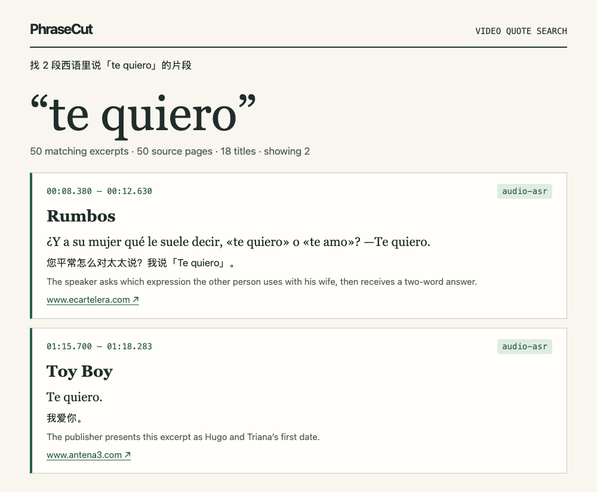

# PhraseCut · 一句话找视频台词

**想剪一句「我爱你」，先找到演员说出口的那几秒。** 给 PhraseCut 一个词或短语，它会在已有视频台词和字幕索引里找出原话，列出来源、入点、出点、场景和核对依据。剪访谈、做影视混剪、找语言教学例句，都可以从同一个问题开始。

**Find the moment someone says a line.** Multilingual video quote search for creators and editors. Search timed subtitles and dialogue, inspect the source, then clip a local video with FFmpeg when needed. By [@wzinian-star](https://github.com/wzinian-star). [English quick start](docs/english.md)



## 从一句话开始

下载仓库 ZIP 并解压，在含有 `phrasecut.py` 的目录运行。检索和建索引只用 Python 3.9+ 标准库，可离线使用。

```sh
python3 phrasecut.py search '找 2 段西语里说「te quiero」的片段'
python3 phrasecut.py search 'Find 1 English clip saying “could be dying”'
```

第一条会返回《Rumbos》和《Toy Boy》。打开《Rumbos》的来源页，从 **00:08.380** 播到 **00:12.630**：一个人问对方平时跟妻子说 *te quiero* 还是 *te amo*，对方回答 *Te quiero*。坐标从链接里的视频第一帧起算。[《Rumbos》原节选](https://www.ecartelera.com/videos/clip-rumbos-te-amo-o-te-quiero/)

第二条会返回 ECAM 2018 英语短片的 **05:34.000–05:39.500**。说话者担心有人可能快死了，接着质问对方怎么还在想父母。两条命令都能在离线索引中复现；在线播放器的访问条件和版本由片源方决定。[英语片源](https://mediateca.educa.madrid.org/video/s676kx3asrhxjy77)

## 《Te quiero》是怎么找到的

> “让去找20个西班牙不管是电影还是电视剧里说te quiero的片段”
> —— 创作者最初的需求节选

制作先保留已选的 **20 段**，再补 **30 段**。最后采用了 **50 个片段、50 个不同的官方或发行媒体节选页面，来自 18 部影视作品**。这是入选素材的计数。一个剧集的不同场景可以各有一个来源页。制作记录保留了每段原片剪点、成片位置、离线识别和音轨对齐结果。公开目录让你逐条回到原片。[查看 50 段带时间码的片源目录](docs/te-quiero.md)

## 加入自己的素材

手上已有一条原语言 SRT 或 WebVTT 字幕就能建索引。下面的 VTT 是为演示导入而写的三条字幕，来源标识对应一段虚构的棚拍。使用自己的字幕时，填原片链接或稳定的本地素材编号。

```sh
python3 phrasecut.py index examples/studio-notes.vtt --title "Studio notes" --lang en --source studio-demo --out studio-index.json
python3 phrasecut.py search 'Find 2 English clips saying “wide shot”' --supplement studio-index.json
```

结果有 1 条，缺 1 条。命中处 **00:02.000–00:04.250** 的前一句在问要不要试广角镜头，下一句说明舞者需要活动空间。重复建相同索引会复用文件。用 `--index` 指定常用索引，按优先级重复传 `--supplement` 添加备用索引；一旦找到所需数量，就跳过其余备用索引。首次检索、缺口补查和重复查询都不会自动联网、下载或启动识别模型。

## 查回原话，再决定怎么剪

| 结果标签 | 你可以据此判断什么 |
| --- | --- |
| `subtitle` | 原语言字幕在这个时间段包含该词。可查看相邻字幕并回听音轨。 |
| `edit-transcript` | 剪辑台词表有这句话。该次查询的词没有单独的原声识别证据。 |
| `audio-asr` | 对应音轨已有该词的离线识别记录。识别结论限定在命中的词，整句标点、说话人和情绪仍可复查。 |

```sh
python3 phrasecut.py search 'te quiero' --lang es --limit 2 --html > review.html
python3 phrasecut.py search 'te quiero' --lang es --limit 2 --json
```

打开新生成的 `review.html`，可点击每条结果的来源。公开截图取自这个页面。使用已获准剪辑且时间轴相同的本地视频，可执行以下命令。剪辑需要已有的 `ffmpeg` 和 `ffprobe`。请使用新输出文件名。

```sh
python3 phrasecut.py clip rumbos-source.mp4 rumbos-line.mp4 --start 8.38 --end 12.63
```

## 在 Codex 里用一句话

项目内附带 [PhraseCut Skill](.agents/skills/phrasecut/SKILL.md)。在支持项目 Skill 的客户端打开此仓库后，可直接说 “找 8 个英语采访里嘉宾说 I’m good、用来婉拒别人的片段”。Skill 会先查已有索引，再按采访类型和语境筛选，报告缺几段。若允许外部补搜，可定向查缺少的原语言字幕，只核对入围时间窗。

CLI 接受纯短语，或用引号标出原话的一句话请求；可显式指定 `--lang` 和 `--limit`。CLI 在同一条字幕或台词内匹配，保留词序和重音，忽略大小写及词间标点。内置真实案例实测了西语和英语。其他语言可导入 Unicode 字幕，分词和效果需按语种验证。类型、人物关系和「委婉拒绝」这类意图由使用者或 Skill 结合语境判断。

## 验证与公开范围

```sh
python3 -m unittest discover -s tests -v
```

西语 50 段沿用了制作时逐段识别和音轨对齐的证据，本次另外实际截出《Rumbos》片段并重新离线识别。英语案例使用此前保留的 15 秒本地片样，截取其中前 5.5 秒并重新离线识别，按原截取记录的 **334 秒偏移** 换算回来源播放器。英语案例的来源页本轮未联网复验。对白区间为可回看的场景窗口。

公开包包含工具、Skill、来源、时间码与检索页截图。影视剪辑、封面、海报、含影视画面的案例图保留在制作端，公开再分发授权尚待核实。仓库维护者为 [@wzinian-star](https://github.com/wzinian-star)。
